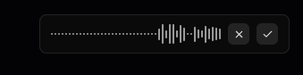
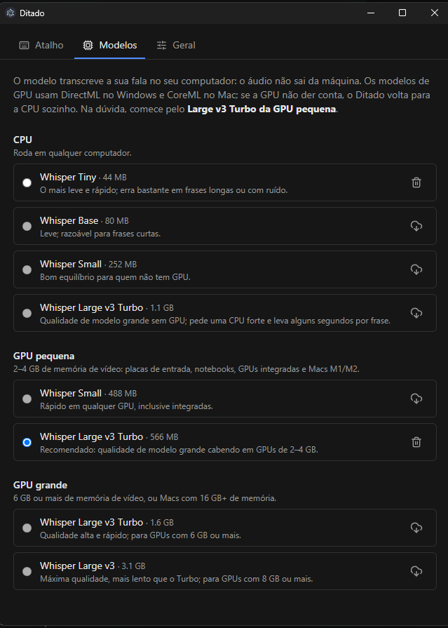
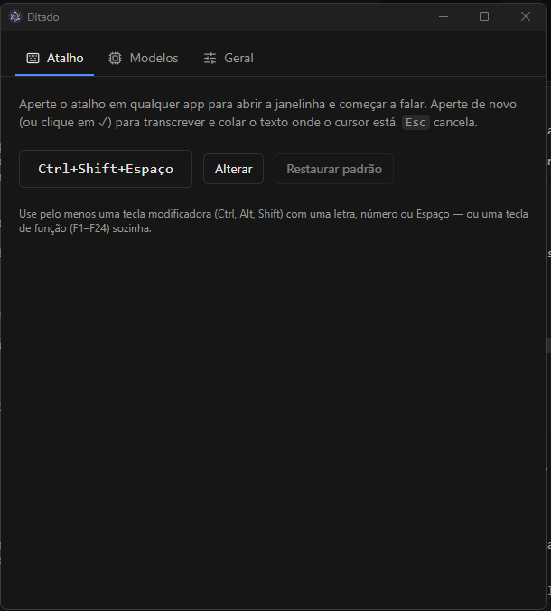
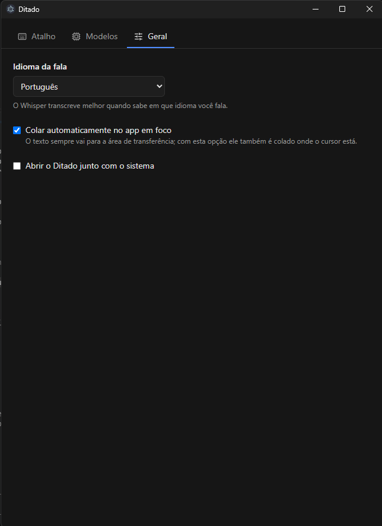

# Ditado

Ditado por voz para **Windows** e **macOS** que roda no seu computador. Aperte um atalho em qualquer app, fale
e o texto aparece onde o cursor está. A transcrição é feita pelo **Whisper** localmente, na GPU ou na CPU:
o áudio não sai da máquina.



## Como funciona

1. Em qualquer app, aperte o atalho (padrão **Ctrl+Shift+Espaço**; no Mac, **⌘⇧Espaço**).
2. Uma janelinha aparece no canto superior direito da tela, mostrando a onda do microfone. Fale.
3. Aperte o atalho de novo (ou clique em **✓**). O texto é transcrito, **colado no app em que você estava** e
   também fica na área de transferência.
4. **Esc** (ou **✕**) cancela a gravação sem colar nada.

O Ditado fica na bandeja do Windows (ou na barra de menu do Mac). No Windows, clique no ícone para abrir as
configurações; no Mac, clique nele e escolha **Configurações...**.
Você pode arrastar a janelinha para outro lugar; a posição fica salva.

## Instalação

Baixe o instalador da sua plataforma (ou gere um, veja [Compilação](#compilação)).

### Windows

1. Execute `Ditado Setup <versão>.exe`.
2. O instalador não tem assinatura digital, então o Windows mostra o aviso do SmartScreen. Clique em
   **Mais informações → Executar assim mesmo**.
3. Na página **Opções**, escolha:
   - **Criar atalho na área de trabalho**;
   - **Iniciar o Ditado junto com o Windows**.

   O atalho vem marcado; iniciar junto com o Windows vem desmarcado. O atalho no Menu Iniciar é criado sempre. Depois dá para ligar ou desligar o início
   automático na aba **Geral**.
4. Na primeira vez que o app abrir, a aba **Modelos** aparece. Siga o [Primeiro uso](#primeiro-uso).

Ao desinstalar, o atalho da área de trabalho e o início automático também são removidos.

### macOS

1. Abra o arquivo `.dmg` do Ditado e arraste o **Ditado** para **Aplicativos**.
2. O app não tem assinatura da Apple, então na primeira vez abra com **botão direito → Abrir → Abrir**.
3. Na primeira vez, as configurações abrem com um aviso de boas-vindas. Marque ou desmarque **Iniciar o Ditado
   junto com o Mac** e clique em **OK**. Dá para mudar depois na aba **Geral**.
4. O Ditado pede duas permissões:
   - **Microfone**, na primeira gravação;
   - **Acessibilidade**, para colar o texto sozinho em outros apps. Ative o Ditado em
     **Ajustes do Sistema → Privacidade e Segurança → Acessibilidade**. Sem essa permissão, o texto vai só
     para a área de transferência e você cola com ⌘V.

O ícone fica na barra de menu, não no Dock.

## Primeiro uso

Abra as configurações (clique no ícone da bandeja ou da barra de menu) e vá para a aba **Modelos**. Baixe um
modelo clicando na nuvem. O primeiro modelo baixado já fica escolhido.



### Qual modelo escolher?

| Faixa | Modelo | Download | Para quem |
|---|---|---|---|
| CPU | Whisper Tiny | 44 MB | Testar rápido; erra bastante |
| CPU | Whisper Base | 80 MB | Frases curtas |
| CPU | Whisper Small | 252 MB | Quem não tem GPU |
| CPU | Whisper Large v3 Turbo | 1,1 GB | Qualidade alta sem GPU (CPU forte, alguns segundos por frase) |
| GPU pequena | Whisper Small | 488 MB | Qualquer GPU, inclusive integradas |
| GPU pequena | **Whisper Large v3 Turbo** ⭐ | 566 MB | **Recomendado.** GPUs de 2–4 GB, notebooks, Macs M1/M2 |
| GPU grande | Whisper Large v3 Turbo | 1,6 GB | GPUs com 6 GB ou mais |
| GPU grande | Whisper Large v3 | 3,1 GB | Máxima qualidade; GPUs com 8 GB ou mais |

**Na dúvida, use o Large v3 Turbo da faixa "GPU pequena".** Os modelos de GPU usam **DirectML** no Windows
(funciona com NVIDIA, AMD e Intel, sem precisar instalar CUDA) e **CoreML** no Mac. Se a GPU não conseguir
carregar ou rodar o modelo, o Ditado passa para a CPU sozinho e avisa na janelinha.

Medição numa RTX 3090, com 10 segundos de fala em português:

| Modelo | Onde rodou | Tempo |
|---|---|---|
| Large v3 Turbo (GPU pequena) | GPU (DirectML) | 0,7 s |
| Large v3 Turbo (GPU pequena) | CPU | 16 s |

A primeira transcrição depois de abrir o app demora um pouco mais, porque o modelo é carregado na memória. O
Ditado começa a carregar o modelo assim que a janelinha abre, enquanto você fala. Depois de 15 minutos sem
uso, o modelo sai da memória.

Os modelos ficam em:

- Windows: `%APPDATA%\Ditado\models`
- macOS: `~/Library/Application Support/Ditado/models`

Para apagar um modelo, use a lixeira ao lado dele.

## Configurações

### Atalho



Clique em **Alterar** e pressione a nova combinação. Use pelo menos uma tecla modificadora (Ctrl, Alt, Shift
ou ⌘) com uma letra, um número ou Espaço, ou então uma tecla de função (F1–F24) sozinha. Se outro app já usa a
combinação, o Ditado avisa e mantém o atalho anterior. **Restaurar padrão** volta para Ctrl+Shift+Espaço.

### Geral



- **Idioma da fala**: o Whisper transcreve melhor quando sabe o idioma. Em "Automático", vale o idioma do
  sistema.
- **Colar automaticamente no app em foco**: desligado, o texto vai só para a área de transferência.
- **Abrir o Ditado junto com o sistema**.

## Compilação

### Requisitos

- [Node.js](https://nodejs.org) 22 ou mais novo (testado com o 24) e npm
- Git
- Para gerar o instalador do Mac, é preciso um **Mac**: o `.dmg` não é gerado no Windows.

### Rodar em modo de desenvolvimento

```bash
git clone https://github.com/RAFAEL-SILVASOUZA/ditado.git
cd ditado
npm install
npm run dev
```

Se aparecer `Error: Electron uninstall`, é porque o `npm install` não baixou o binário do Electron. Rode:

```bash
node node_modules/electron/install.js
```

Feche o Ditado instalado antes de rodar o modo dev: os dois disputam o mesmo atalho global. Em modo dev, a
opção "Abrir junto com o sistema" só é salva, sem registrar nada no sistema (o executável seria o do Electron).

### Testes e verificação de tipos

```bash
npm test
npm run typecheck
```

### Gerar o instalador

```bash
npm run build:win   # Windows: dist/Ditado Setup <versão>.exe
npm run build:mac   # macOS (num Mac): arquivo .dmg em dist/
```

O build usa o Electron já baixado em `node_modules` (`electronDist` no `electron-builder.yml`), então cada
sistema gera o próprio instalador. As opções do instalador do Windows ficam em `build/installer.nsh`.

O ícone do app está em `build/icon.ico` (Windows) e `build/icon.png` (Mac e bandeja). A versão vem do campo
`version` do `package.json`.

## Como é feito

- **Electron + React + TypeScript**, empacotado com electron-vite e electron-builder.
- **Transcrição**: Whisper em ONNX (modelos do [onnx-community](https://huggingface.co/onnx-community)) pelo
  [`@huggingface/transformers`](https://github.com/huggingface/transformers.js), no processo principal, com
  `onnxruntime-node`. GPU via DirectML (Windows) ou CoreML (macOS), com volta automática para a CPU.
- **Janelinha**: uma janela sem moldura, sempre por cima, que **nunca recebe o foco**. Por isso o app em que
  você estava continua em foco e recebe a colagem.
- **Colagem**: o texto vai para a área de transferência e o Ditado simula Ctrl+V (Windows, pelo PowerShell) ou
  ⌘V (macOS, pelo System Events), sem módulos nativos.

```
src/
├─ main/        processo principal: atalhos, janelas, bandeja, modelos, transcrição, colagem
├─ preload/     ponte segura entre as janelas e o processo principal
├─ renderer/    janelinha (overlay) e janela de configurações
└─ shared/      tipos e contratos de IPC
```

O desenho completo está em [`docs/design.md`](docs/design.md).

## Limitações conhecidas

- O atalho funciona no modo liga/desliga. Segurar a tecla para falar ainda não é suportado.
- O texto aparece de uma vez no fim, não enquanto você fala.
- Os instaladores não têm assinatura digital (SmartScreen no Windows; "botão direito → Abrir" no Mac).

## Privacidade e contribuições

A transcrição é local. Os modelos precisam ser baixados antes do uso offline. O texto fica no clipboard; evite mudar de janela durante a transcrição com colagem automática ativa. Veja [Privacidade](PRIVACY.md), [Segurança](SECURITY.md) e [Como contribuir](CONTRIBUTING.md).

## Licença

O código do Ditado usa a [licença MIT](LICENSE).
